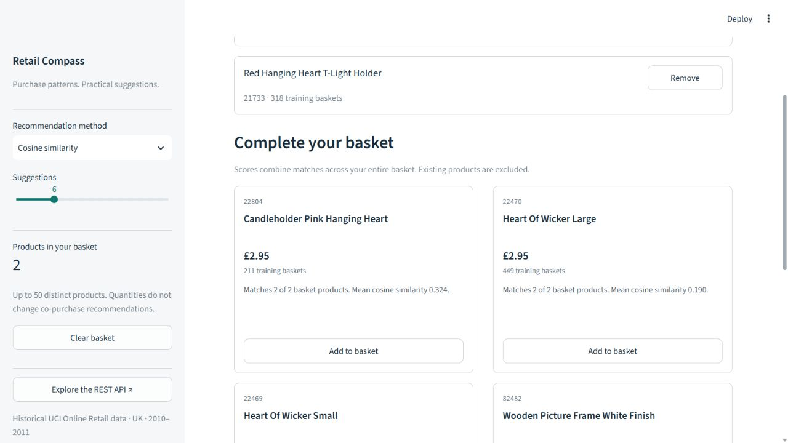
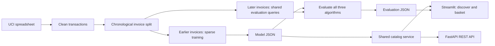

# E-Commerce Product Recommendation System

**Retail Compass** is a practical recommendation project built from real retail
purchases: a sparse item-to-item engine, a validated FastAPI backend, and a clean
Streamlit dashboard with an interactive shopping basket.

It is deliberately small enough to explain, test, and run locally. The application
uses precomputed JSON artifacts; training and dataset downloads never run on requests.



## Features

- Product search by name or stock code, with deterministic ranking and pagination.
- Cosine similarity, frequently bought together, and popularity recommendations.
- Multi-product basket suggestions with normalized scores, duplicate removal,
  exclusion of existing products, and a full-catalog popularity fallback.
- Recommendation cards with historical prices, supporting basket counts, and
  explanations. Add, remove, and clear basket products.
- Retail analytics and verified single-product/basket evaluation at top 5 and 10.
- Versioned REST endpoints, OpenAPI docs, validation, and clear 404/422/503 errors.
- Bounded search/recommendation caches and graceful handling of missing artifacts.
- Automated algorithm, data, leakage, metric, API, and UI interaction tests.

## Architecture



Streamlit calls the shared Python service directly, so the UI runs independently
of the API process. External clients use FastAPI. Both paths use the same search,
ranking, caching, and explanation logic.

| File | Responsibility |
| --- | --- |
| `src/data.py` | Atomic download and purchase cleaning |
| `src/recommender.py` | Sparse fitting and single/basket inference |
| `src/evaluation.py` | Strict chronological split, query generation, and metrics |
| `src/build.py` | Reproducible build, source checksum, and artifact provenance |
| `src/storage.py` | Atomic JSON writes and matched model/report loading |
| `src/service.py` | Shared catalog, search, bounded caches, and explanations |
| `src/api.py` | FastAPI validation and REST endpoints |
| `app.py` | Streamlit interface |
| `tests/` | Synthetic, deterministic checks; no network or dataset download |

## Run locally

Python **3.11+** is required; Python 3.12 is a convenient choice for a new environment.
The current real-data build and tests were verified in WSL on Python 3.14.4.
Exact scientific-package versions and the source SHA-256 are recorded in
[`reports/evaluation.json`](reports/evaluation.json).

### Linux, macOS, or WSL

Run from this repository's directory:

```bash
python3 -m venv .venv
.venv/bin/python -m pip install -r requirements.txt
.venv/bin/python -m streamlit run app.py
```

In a second terminal, start the API:

```bash
.venv/bin/python -m uvicorn src.api:app --host 127.0.0.1 --port 8000
```

Open the UI at [localhost:8501](http://localhost:8501) and the interactive API docs
at [localhost:8000/docs](http://localhost:8000/docs).

### Windows PowerShell

For a **Windows** virtual environment:

```powershell
py -3.12 -m venv .venv
.\.venv\Scripts\python.exe -m pip install -r requirements.txt
.\.venv\Scripts\python.exe -m streamlit run app.py
```

In a second terminal:

```powershell
.\.venv\Scripts\python.exe -m uvicorn src.api:app --host 127.0.0.1 --port 8000
```

`setup.bat` installs dependencies, rebuilds the real-data model, and runs tests.
`run.bat` starts the UI; `run_api.bat` starts the backend.

**WSL and Windows environments are different.** A folder containing
`.venv/bin/python` is a Linux environment and cannot be launched with
`.venv/Scripts/python.exe`. Use the Linux commands inside WSL. If you want a second
Windows environment, create it under a different name such as `.venv-win`.
The current local checkout uses WSL.

### Rebuild and evaluate

The repository includes a real-data model and its matching evaluation report, so
the dashboard and API can start without downloading the raw spreadsheet.

```bash
.venv/bin/python -m src.build
.venv/bin/python -m pytest -q
```

Replace `.venv/bin/python` with `.\.venv\Scripts\python.exe` on Windows.
The build downloads the official spreadsheet only if it is missing. Alternatively:

```bash
.venv/bin/python -m src.build --data "/path/to/Online Retail.xlsx"
.venv/bin/python -m src.build --data transactions.csv --max-products 1200 --output-dir .
```

CSV input must contain `InvoiceNo, StockCode, Description, Quantity, InvoiceDate,
UnitPrice`. Raw data is intentionally gitignored. Restart FastAPI after rebuilding;
it loads one immutable model snapshot at startup. Streamlit invalidates its cache
when the artifact file changes. Model/report build IDs prevent showing mismatched results.

## Recommendation methods

Training uses **binary invoice membership**, not quantities or ratings. Only
invoices containing 2–40 distinct products are modeled. Select at most 1,200
products appearing in at least five training baskets. Require at least two joint
training baskets for a product-pair association.

For basket-product matrix `X`, compute one sparse `X.T @ X`. No dense product
matrices or duplicate cosine matrix multiplication are needed.

- **Cosine:** `joint(A,B) / sqrt(orders(A) * orders(B))`.
- **Frequently bought together:** rank by joint count for one seed. For multiple
  seeds, average `joint(seed,candidate) / orders(seed)` so seed frequency does not
  dominate basket ranking.
- **Popularity:** order products by training-basket frequency.

Basket cosine scores average similarity across all distinct seed products.
Candidates come from the union of the seeds' stored top-50 neighbors per method.
Deterministic ties use matched-seed count, pair support, then stock code.
Exclude every seed and already-added product; fill remaining slots from the full
popular catalog. Empty baskets use popularity. The low-level engine also supports
unknown-seed fallback; REST endpoints reject unknown catalog codes with 404.

Scores from different methods, or from fallback versus association results, have
different meanings and should not be compared as calibrated purchase probabilities.
Fallback items are explicitly labelled. Basket pair counts can overlap, so their sum
is not presented as a number of unique joint invoices.

Displayed prices are median **historical training unit prices in GBP**. They are
reference values, not current offers or checkout prices.

## Verified evaluation

The build trains on earlier invoices and evaluates later invoices around an 80/20
boundary. Timestamp ties stay together. Entire invoices spanning the boundary are
excluded, ensuring **every training timestamp precedes every test timestamp**.
Catalog selection, names, prices, popularity, and similarities use training data only.

For this build:

- Training: **15,816 invoices**, including **12,194 modeled baskets** and 1,200 products.
- Test: **3,955 invoices**, of which 3,020 meet the basket-size filter.
- Boundary: **2011-10-26 13:27** in the source's unzoned invoice timestamps.
- Single-product task: **2,882** eligible invoices; reveal one item and retrieve the rest.
- Basket task: **2,698** eligible invoices; reveal 2–3 items and retrieve the remainder.
- Training-catalog products cover **75.42% of item occurrences** in size-filtered test baskets.
- All eligible invoices are used, with fixed random seed 42. All algorithms receive
  identical queries for each task; no hyperparameters were selected using these test scores.

**Single-product retrieval — percentages**

| Algorithm | HitRate@5 | Recall@5 | Coverage@5 | HitRate@10 | Recall@10 | Coverage@10 |
| --- | ---: | ---: | ---: | ---: | ---: | ---: |
| Cosine similarity | 50.45 | 11.09 | 90.75 | 59.58 | 15.10 | 97.67 |
| Frequently bought together | 53.37 | 11.55 | 72.67 | 62.87 | 15.86 | 82.50 |
| Popularity | 23.46 | 2.82 | 0.50 | 31.44 | 4.23 | 0.92 |

**Basket completion — percentages**

| Algorithm | HitRate@5 | Recall@5 | Coverage@5 | HitRate@10 | Recall@10 | Coverage@10 |
| --- | ---: | ---: | ---: | ---: | ---: | ---: |
| Cosine similarity | 64.05 | 15.97 | 83.33 | 73.09 | 22.02 | 92.42 |
| Frequently bought together | 63.01 | 15.12 | 61.75 | 72.72 | 21.22 | 73.33 |
| Popularity | 20.53 | 2.71 | 0.58 | 28.50 | 4.32 | 1.00 |

HitRate is the share of evaluated invoices with at least one relevant top-k result.
Recall is the mean fraction of hidden eligible products recovered. Coverage is the
fraction of the training catalog recommended across the evaluation queries.

Co-purchase had the higher single-product HitRate in this run. Cosine had the higher
basket HitRate and broader catalog exposure. The old report used a different sampled
query protocol, so these results are not a controlled before/after comparison.

**Limits:** Relevance is restricted to products already in the training catalog;
unknown products and excluded wholesale-size baskets are not represented in these
scores. The source contains repeat customers and wholesale purchases. Offline
co-purchase retrieval does not establish sales uplift or personal preference.
A real business claim would require an online experiment.

## REST API

`python -m uvicorn src.api:app --port 8000` starts the backend.
[Swagger UI](http://localhost:8000/docs) and
[OpenAPI JSON](http://localhost:8000/openapi.json) describe request/response schemas.

| Method | Route | Purpose |
| --- | --- | --- |
| GET | `/health` | Readiness, model build ID, catalog count |
| GET | `/api/v1/products?q=heart&limit=20&offset=0` | Case-insensitive token search with pagination |
| GET | `/api/v1/products/{product_id}` | Product metadata |
| GET | `/api/v1/recommendations/{product_id}?method=similarity&k=8` | Single-product recommendations |
| POST | `/api/v1/recommendations/basket` | Multi-product recommendations; empty basket uses popularity |
| GET | `/api/v1/evaluation` | Verified report matching the loaded model |

Bash examples:

```bash
curl "http://localhost:8000/api/v1/products?q=heart&limit=3"
curl "http://localhost:8000/api/v1/recommendations/85123A?method=similarity&k=5"
curl -X POST "http://localhost:8000/api/v1/recommendations/basket" -H "Content-Type: application/json" -d '{"product_ids":["85123A","22469"],"method":"similarity","k":5}'
```

Basket request:

```json
{
  "product_ids": ["85123A", "22469"],
  "method": "similarity",
  "k": 5
}
```

The response includes `query_products`, `method`, `recommendations`,
`fallback_count`, and `build_id`. Each recommendation contains its ID, name,
training order count, historical price, score, source, matched seed codes,
optional single-seed joint-order count, fallback flag, and explanation.

Validation rules:

- `method`: `similarity`, `frequently_bought`, or `popularity`.
- `k`: integer 1–50. Basket JSON rejects floats, booleans, and unknown fields.
- `product_ids`: at most 50 nonempty string codes. Normalize case/whitespace and
  deduplicate before ranking. Empty lists are allowed.
- Search: query at most 100 characters, limit 1–100, offset >= 0.
- 404: unknown catalog codes, including an explicit list of unknown basket codes.
- 422: invalid parameters or malformed request bodies.
- 503: missing/invalid model, or unavailable/mismatched evaluation report.
- Missing evaluation does not prevent recommendation serving. The API docs stay
  available if the model is missing.

## Quality and interview preparation

Run `python -m pytest -q` inside the activated environment, or use its explicit
Python path. The suite verifies actual ranking and metric values, duplicate and
exclusion behavior, full fallback, strict chronological separation, future-data
isolation, atomic downloads, HTTP validation/errors, cache response isolation,
and Streamlit search/add/remove/clear/analytics flows. Tests use synthetic fixtures
and do not download data. GitHub Actions is configured for Python 3.12 on Windows
and Ubuntu; a local test run does not claim that hosted CI has run.

The final local run passed **81 tests** with deprecation warnings treated as errors;
`pip check` found no dependency conflicts. Desktop and 390-pixel phone layouts were
checked in a browser. See [verification details](reports/verification.json) and the
[evaluation screenshot](docs/screenshots/evaluation.jpg).

Read [the audit](docs/AUDIT.md) for findings and fixes, and
[the interview guide](docs/INTERVIEW_GUIDE.md) for a demo and design tradeoffs.
The project adds no database, authentication, or checkout system.

The Streamlit basket is session-only. Search caches retain up to 128 queries;
recommendation caches retain up to 512 distinct requests per loaded service.
API model changes take effect on restart. New-product/content-based recommendations,
large-scale retrieval, persistent carts, and online experiments are future work.

## Dataset and references

[UCI Online Retail](https://archive.ics.uci.edu/dataset/352/online+retail),
Chen (2015), [DOI 10.24432/C5BW33](https://doi.org/10.24432/C5BW33),
CC BY 4.0. The source contains 541,909 transaction lines; it has no explicit ratings.
Cleaning removes cancellations, missing/empty required fields, non-product stock
codes, invalid dates, and nonpositive/nonfinite quantities and prices. Duplicate
purchase lines do not increase binary basket membership.

Implementation references:
[FastAPI lifespan and testing](https://fastapi.tiangolo.com/advanced/testing-events/),
[Streamlit containers](https://docs.streamlit.io/develop/api-reference/layout/st.container),
and [Streamlit number columns](https://docs.streamlit.io/develop/api-reference/data/st.column_config/st.column_config.numbercolumn).
